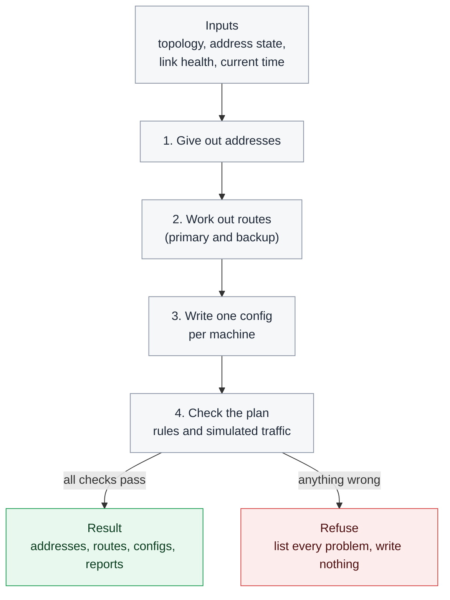

# netctl

**A pure-Go library for planning private overlay networks.**

[](https://github.com/vectorihub/netctl/actions/workflows/ci.yaml)
[](https://github.com/vectorihub/netctl/releases)
[](https://pkg.go.dev/github.com/vectorihub/netctl)
[](go.mod)
[](LICENSE)

`netctl` decides how a private network should look: which addresses belong to which machines, which links exist,
and who may reach whom. It never touches a real machine. It reads a description of the network, checks it, and
returns data that other programs carry out.

It has no daemon, no command line, no network access and no file access. Everything it needs is passed in as
values, and the same input always gives the same output, byte for byte. That makes it fast to test, easy to
embed, and safe to run anywhere.

`netctl` is the planner behind [Beaver Cloud](https://github.com/vectorihub), and is built to be useful on its own.

> **Status: pre-1.0.** Address management and the topology model are released (`v0.3.0`). Routing, packet
> simulation, failover and plan generation are on the [roadmap](#roadmap). Until `v1.0.0`, a minor release may
> contain breaking changes; each one is listed in the [changelog](CHANGELOG.md).

**Jump to:**
[Getting started](#getting-started) ·
[Packages](#packages) ·
[Design principles](#design-principles) ·
[Roadmap](#roadmap) ·
[Development](#development) ·
[Contributing](#contributing) ·
[Getting help](#getting-help) ·
[License](#license)

---

## Getting started

### Requirements

- Go 1.25 or newer

### Install

```sh
go get github.com/vectorihub/netctl@v0.3.0
```

### Quick start

This program gives a site and a machine their addresses, then reads, checks and fingerprints a network
description. Each part is independent, so use only what you need.

```go
package main

import (
	"fmt"
	"log"
	"net/netip"
	"os"
	"time"

	"github.com/vectorihub/netctl/ipam"
	"github.com/vectorihub/netctl/topology"
	"github.com/vectorihub/netctl/types"
)

func main() {
	// Addresses: a supernet cut into pools, and a clock you control.
	clock := &types.FixedClock{T: time.Date(2026, 11, 19, 9, 0, 0, 0, time.UTC)}
	registry, err := ipam.New(ipam.Snapshot{
		Schema:   ipam.Schema,
		Supernet: netip.MustParsePrefix("10.42.0.0/16"),
		Pools: []ipam.Pool{
			{Name: "sites", Prefix: netip.MustParsePrefix("10.42.0.0/17"), ChildBits: 20},
			{Name: "overlay", Prefix: netip.MustParsePrefix("10.42.240.0/21"), ChildBits: 32, SkipFirst: 1},
		},
	}, clock, ipam.DefaultQuarantine)
	if err != nil {
		log.Fatal(err)
	}

	site, _ := registry.Allocate("sites", ipam.Site("builder"))
	node, _ := registry.Allocate("overlay", ipam.Node("builder-1"))
	owner, _ := registry.OwnerOf(node.Prefix.Addr())
	fmt.Println(site.Prefix, node.Prefix, owner) // 10.42.0.0/20 10.42.240.1/32 node:builder-1

	// Topology: read, check and fingerprint a network description.
	data, err := os.ReadFile("three-site.yaml") // you read the file; netctl never does
	if err != nil {
		log.Fatal(err)
	}
	network, report, err := topology.Load("three-site.yaml", data, 0)
	if err != nil {
		log.Fatal(err) // every problem at once, each with its rule and place
	}
	for _, warning := range report.Warnings() {
		fmt.Println(warning)
	}
	graph := topology.BuildGraph(network, nil)
	fmt.Println(len(network.Nodes), "nodes,", graph.EdgeCount(), "edges, hash", network.Hash()[:12])
}
```

The topology file is plain YAML:

```yaml
schema: beaver.topology/v1alpha1
name: three-site

sites:
  - { id: aws, provider: aws, region: eu-west-1 }
  - { id: builder, provider: owned }
  - { id: dgx, provider: owned }

nodes:
  - { id: aws-hub,   site: aws,     role: hub,   nat: none, endpoints: [203.0.113.10:51820] }
  - { id: builder-1, site: builder, role: spoke, nat: behind, advertises: [site] }
  - { id: dgx-spark, site: dgx,     role: spoke, nat: behind, advertises: [site] }

links:
  - { kind: hub-spoke, a: aws-hub,   b: builder-1 }
  - { kind: hub-spoke, a: aws-hub,   b: dgx-spark }
  - { kind: direct,    a: builder-1, b: dgx-spark, cost: 10 }

intents:
  - allow: { from: builder-1, to: dgx-spark }
  - deny:  { from: "site:builder", to: "site:aws", ports: [5432] }
```

A mistake is reported with its file, line and a hint, and every mistake is reported at once:

```text
INVALID_TOPOLOGY: three-site.yaml:17: nodes[0]: unknown field "rol"; did you mean "role"?
```

---

## Packages

| Package | What it does | Status |
|---|---|---|
| [`types`](types) | Shared vocabulary: node, site and link IDs, roles, link kinds, coded errors (`OVERLAP`, `POOL_EXHAUSTED`, …) and an injectable clock. | Released |
| [`cidr`](cidr) | Address-block maths on `net/netip`: canonicalise, split, subtract, compare, count usable addresses. | Released |
| [`ipam`](ipam) | IP address management: pools, allocation, reservation, release with quarantine, lookup, accounting that proves no space is lost, and byte-stable snapshots. | Released |
| [`topology`](topology) | The network model: strict YAML loading, defaults and ordering, validation rules, selectors, adjacency import, a graph view and a canonical hash. | Released |
| `route` | Shortest paths, routing tables with backups, longest-prefix match. | Planned |
| `sim` | A packet simulator that finds dead ends, loops and one-way paths in a plan. | Planned |
| `health`, `failover` | Link health and the rules for failing over and back. | Planned |
| `config`, `validate`, `plan` | Per-machine configuration, whole-plan validation, and `Plan`, the single entry point. | Planned |

### What you can do today

- **Hand out addresses safely.** Give every site, machine and link a unique block. No two owners overlap,
  a released block rests in quarantine before reuse, and `Accounting()` shows allocated, reserved, quarantined
  and free space adding up to the whole.
- **Answer "who owns this address?"** `OwnerOf(10.42.240.2)` returns `node:builder-1`.
- **Describe a network once, and trust it.** `topology.Load` refuses ambiguous input, applies defaults in one
  place, and reports rule violations such as a duplicate node, a link to a missing machine, or a spoke with no path
  to a hub. A direct link between two machines behind NAT is a warning, not an error.
- **Resolve who an intent applies to.** `site:builder`, `label:env=prod`, `node:x` and `*` resolve to a sorted list.
- **Import per-node adjacency lists.** If one side lists a peer and the other does not, the import is refused,
  so a one-sided link can never get in.
- **Fingerprint a network.** `Hash()` ignores ordering, comments and whitespace, and changes when the network does.

---

## Design principles

- **Plan, never do.** `netctl` decides; a separate agent applies. This keeps the planner testable on a laptop in
  milliseconds. An architecture test (`make arch`) fails the build if a package ever gains the ability to run
  programs, use the network, open a database or touch the operating system.
- **Pure and repeatable.** No clock, file, environment or network reads in library code (`make lint` enforces it).
  Time and state are passed in. Output is sorted, so equal inputs give equal bytes.
- **Refuse, don't guess.** Unknown fields, repeated fields, wrong types and unknown schema versions are errors.
  Every problem is reported together, not one per run.
- **Typed errors.** Failures carry a stable code. Match them with `errors.Is` or `types.HasCode`, never by message text.
- **`net/netip` everywhere.** Addresses and prefixes are never `net.IP`. See [ADR 0002](docs/adr/0002-netip-everywhere.md).
- **Small footprint.** One runtime dependency, `gopkg.in/yaml.v3`, used only by the topology loader. The types
  in `topology/types.go` import no YAML, so a topology can be built in Go from database rows just as well.

How one plan will be produced, once the later packages land:



Step 1 is available now through `ipam`, and `topology` provides the network description that feeds it.

---

## Roadmap

Development runs in five phases, each ending in a pass/fail gate. The next phase does not start until the gate passes.

| Phase | Goal | State |
|---|---|---|
| **1. Network intelligence** | Plan the network on paper and prove the plan works: addresses, topology, routing, simulation, failover, validation. Pure logic. | In progress: addresses and topology released |
| **2. Private connectivity** | Build real encrypted links between real machines. | Planned |
| **3. Security** | Machine identity, a policy engine for who may talk to whom, and host hardening. | Planned |
| **4. Platform** | A control plane that runs the planner continuously and distributes configuration. | Planned |
| **5. Reliability** | Survive failures, back up and restore, and prove it with chaos tests. | Planned |

Released so far: [`v0.1.0`](CHANGELOG.md) (types, CIDR maths, tooling), [`v0.2.0`](CHANGELOG.md) (`ipam`) and
[`v0.3.0`](CHANGELOG.md) (`topology`). Next is the routing engine.

---

## Development

```sh
make check      # formatting, vet and tests: the everyday gate
make lint       # purity guard (no clock, files or environment) and staticcheck
make race       # tests under the race detector
make arch       # architecture guard and a Windows build check
make bench      # performance budgets (IPAM allocation, topology load)
make fuzz       # fuzz targets; FUZZTIME=120s for a longer run
```

CI runs these same targets on Ubuntu and macOS, so a green `make check lint race arch` locally means a green build.

### Repository layout

```text
netctl/
├── types/ cidr/ ipam/ topology/      released packages
├── route/ sim/ health/ failover/     planned packages (placeholders for now)
├── config/ validate/ plan/
├── <package>/tests/                  black-box tests for each package
├── arch/tests/                       the architecture guard
├── testdata/                         example topologies and fixtures
└── docs/                             architecture decision records and the release policy
```

---

## Contributing

Contributions are welcome. Open an issue to discuss a change before sending a large pull request.

Please follow the conventions the code already uses:

- **Stay pure.** No reading files, the clock, environment variables or the network, and no operating-system packages.
- **Be repeatable.** Same input, same output. Sort before ranging over a map, and pass time in.
- **Use `net/netip`** for addresses, and **typed errors** with a stable code.
- **Test the exported API** from the package's own `tests/` folder. Only a test that must corrupt private state to
  prove a defence may sit beside the code, and it says why at the top of the file.
- **Comment every function** clearly, including unexported helpers and tests. Exported functions start the comment
  with their name, explain inputs, outputs and errors, and include a short example; add a runnable `Example` test too.
- **One runtime dependency.** Anything new needs a written reason, ideally an ADR in [`docs/adr`](docs/adr).

Run `make check lint race arch` before opening a pull request. Pull requests are also reviewed automatically by
[CodeRabbit](https://coderabbit.ai) and [Greptile](https://www.greptile.com) (see `.coderabbit.yaml` and
`.greptile/config.json`).

### Versioning

netctl follows the rules in [docs/versioning.md](docs/versioning.md): `v0.N.0` for each new era until the
Phase 5 gate, then normal semantic versioning from `v1.0.0`. File formats carry their own schema strings
(`beaver.topology/v1alpha1`, `beaver.ipam/v1`) that change only on a breaking change to that format. What changed in
each release is in [CHANGELOG.md](CHANGELOG.md).

---

## Getting help

- Browse the [API documentation](https://pkg.go.dev/github.com/vectorihub/netctl) and the
  [architecture decision records](docs/adr).
- Search the [issues](https://github.com/vectorihub/netctl/issues), or open a new one with the input that
  fails and the output you expected.
- For a suspected security problem, please do not open a public issue; contact the maintainers privately.

## License

Licensed under the Apache License, Version 2.0. See [LICENSE](LICENSE) and [NOTICE](NOTICE).
