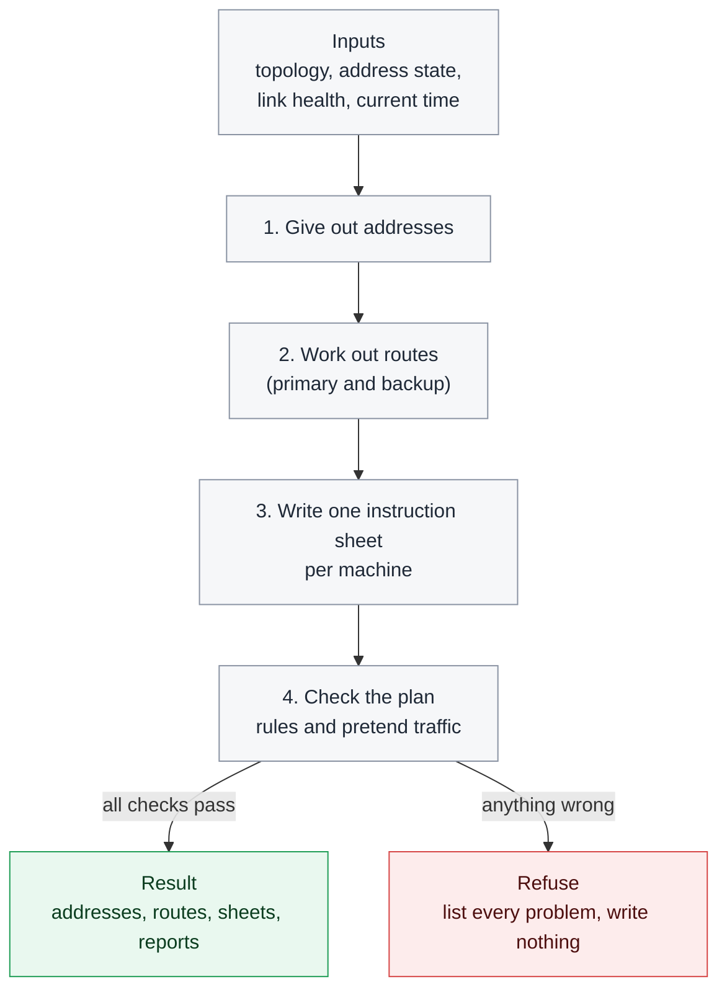
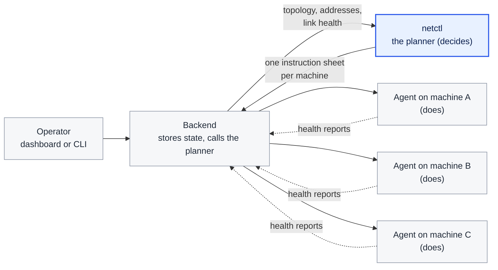
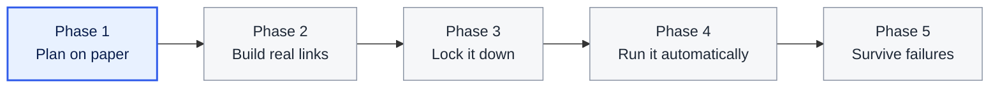

# netctl

**The network planner for Beaver Cloud.**

Beaver Cloud connects machines in different places (a cloud server, your own servers, a GPU box, a Mac)
so they behave like one private network. `netctl` is the part that **decides** how that network
should look. It does not touch any real machine. It works out the plan, checks the plan, and hands the
result to other programs that carry it out.

> **Status: early. Only the project scaffold exists today (V3).** The planner itself is not built yet. See
> [What works today](#what-works-today) and [Roadmap](#roadmap).

---

## Why it exists

Without a single place that decides the network, small mistakes become outages:

| Mistake | What happens |
|---|---|
| Two machines get the same address | Both half-work, and nobody knows why |
| An address is reused too soon | Old traffic reaches the wrong machine |
| A backup route is added by hand | It loops, or replies come back a different way and get dropped |
| A change is made on one machine | Another machine breaks, and you find out in production |

`netctl` removes the guessing. It builds the whole plan on paper first, tests it with pretend
traffic, and refuses to produce anything if the plan is broken.

## What it does

Given a description of your sites, machines and links, the planner will:

1. **Give out addresses.** Every site, machine and link gets a unique address, and no address is ever lost track of.
2. **Work out routes.** For every machine, it finds the next step to reach every other place, plus a backup.
3. **Test the plan.** It sends pretend packets through the plan to catch dead ends, loops and one-way roads.
4. **Handle failures.** It prefers direct links, falls back to the hub when one breaks, and goes back only after the link has proven stable.
5. **Write instructions.** It produces one instruction sheet per machine that does not depend on which operating system will apply it.
6. **Say no.** If anything is wrong, it reports every problem and writes nothing.

How one plan is produced:



The same input always gives the same output, byte for byte. That is what lets other programs tell a real change
from noise.

## How it fits into Beaver Cloud



- **netctl decides.** It never configures a machine.
- **The agent does.** A small program on each machine reads its sheet and makes the machine match it.

Keeping these two apart is the main design rule of the project. It lets the planner be tested on a laptop in
milliseconds, and lets the same decisions drive Linux today and other systems later.

## What works today

Nothing you can run, on purpose. This is a **library, not a program**: it has no command line, no server and
no `package main` (decision D18). Command-line commands are built later in `beaver-cli`.

The repo currently contains:

- a Go module, `github.com/VectorIHub/netctl`, that builds and passes `go vet`
- an empty folder for each part of the planner (addresses, topology, routing, simulation, health, failover,
  configuration, validation, planning), each with a one-paragraph description
- a plan for everything else (see [Roadmap](#roadmap))

Check that it builds:

```sh
go build ./... && go vet ./...
```

## How other programs will use it (planned)

This is the intended shape. **It does not exist yet.**

```go
result, err := netctl.Plan(netctl.Inputs{
    Topology: topology,   // sites, machines, links, who must reach whom
    IPAM:     addresses,  // addresses already handed out
    Health:   health,     // which links are known to be up or down
    Clock:    clock,      // the current time, passed in
})
// result holds the addresses, routes, one config per machine,
// and the validation and simulation reports.
// If the plan is invalid, err says why and no configs are produced.
```

Everything it needs is passed in. It reads no files, no environment variables and no network. That is why it
needs no `.env` file.

## Roadmap

Five phases, each ending with a pass/fail check. The next phase does not start until the check passes.

| Phase | In plain English |
|---|---|
| **1. Network intelligence** | Plan the network on paper and prove the plan works. Pure logic, runs on a laptop. |
| **2. Private connectivity** | Build real encrypted links between real machines. |
| **3. Security** | ID cards for machines, a rulebook for who may talk to whom, and a guard on every machine. |
| **4. Platform** | A control room that runs the planner continuously and sends out instructions automatically. |
| **5. Reliability** | Survive failures, back up and restore, and prove it by breaking things on purpose. |



*Each arrow is a pass/fail gate. Blue marks where the project is today.*

The detailed plan (243 versions in 34 eras) is kept in `features/netctl/`. It is not tracked in git yet. The
source documents are the three PDFs in the repo root, which are also kept out of git.

## Project layout

```
netctl/                     module github.com/VectorIHub/netctl
├── doc.go                  the library's front door (Plan arrives in V74)
├── types/ cidr/ ipam/ topology/ route/ sim/ health/ failover/ config/ validate/ plan/
│                           one folder per job, empty for now
├── policy/ identity/       Phase 3, empty for now
├── internal/               test helpers; never public
├── test/e2e/phase1/        end-to-end suite
├── testdata/               topologies, golden outputs, signals
├── docs/                   decision records (adr/) and phase gates (gates/)
├── .coderabbit.yaml        automated code review settings
├── .greptile/              automated code review settings
└── features/netctl/        the plan, by phase, era and version (not tracked in git)
```

## Writing code in this repo

These rules apply once real code lands. They are also what the automated reviewers check.

- **Stay pure.** No reading files, the clock, environment variables or the network, and no operating-system
  packages. Callers pass everything in.
- **Be repeatable.** Same input, same output. Sort before looping over a map, and pass time in.
- **Use `net/netip`** for addresses, never `net.IP`.
- **Use typed errors** with a stable code (for example `OVERLAP`) and test them with `errors.Is`, not by
  comparing text.
- **One runtime dependency:** `gopkg.in/yaml.v3`. Anything else needs a written reason.
- **Write comments people can hover.** Every exported function has a comment that starts with its name,
  explains inputs, outputs and errors, and includes a short `Example:`. Add a runnable `Example` test too.

## Automated review

Pull requests are reviewed by [CodeRabbit](https://coderabbit.ai) and [Greptile](https://www.greptile.com).
Their settings live in `.coderabbit.yaml` and `.greptile/config.json`. Both are GitHub apps that must be
installed on the repository by an owner.

## Requirements

- Go 1.25 or newer

## Getting help

Open an issue on this repository, or read the plan in `features/netctl/` (start with `00-architecture.docs`).
